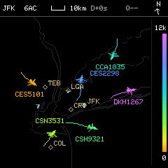
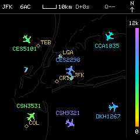

# Airspace Radar

A desktop airspace viewer with a 240 × 240 USB display powered by a Seeed Studio XIAO ESP32C6 and an ST7789 panel.

The Windows app fetches aircraft states from OpenSky and sends geographic scene metadata over USB. The ESP32 handles map projection, aircraft rendering and trails locally. You can also use the desktop preview on its own.

| Oblique 3D view | Top-down 2D view |
| --- | --- |
|  |  |

These screenshots use simulated aircraft. Live coverage depends on OpenSky receiver availability.

## Features

- Search airports by code, name or city, or enter a custom map center.
- Adjust view width, API polling interval and desktop render interval.
- Switch between 2D and 3D, with independent controls for runways, navaids, water outlines and trails.
- Color aircraft and callsigns by altitude, with a vertical altitude legend.
- Draw curved, altitude-colored trails between the two most recent observations.
- Display data age and API-reported remaining credits.
- Authenticate with your own OpenSky OAuth API client.
- Transfer IPS4 scene packets using CRC validation and acknowledged USB chunks.
- Update data age locally on the board and sweep map changes from top to bottom over about two seconds.

## Requirements

The desktop app uses Windows PowerShell 5.1, .NET Framework and WPF. Windows is the currently tested desktop platform.

For the physical display, use a Seeed Studio XIAO ESP32C6 and a 1.3-inch, 240 × 240 ST7789 SPI panel. The supplied firmware targets a seven-pin module without a CS pin.

| Display pin | XIAO pin | GPIO |
| --- | --- | --- |
| GND | GND | — |
| VCC | 3V3 | — |
| SCL / SCK | D8 | 19 |
| SDA / MOSI | D10 | 18 |
| RES | D3 | 21 |
| DC | D2 | 2 |
| BLK | D1 | 1 |

SDA and SCL on this module label the SPI data and clock signals. BLK is treated as a backlight control input. Check your module's backlight driver requirements before wiring it.

## Try the desktop app

For a ready-to-run Windows package, download `AirspaceRadar-v0.1.0-windows.zip` from [Releases](https://github.com/PROMAXULTRA/airspace-radar/releases), extract the entire archive, and double-click `AirspaceRadar.exe`. Keep the bundled `tools` directory alongside the EXE, as the launcher loads the application scripts and data from there.

To run from source, download and extract the complete source tree, then run this command from the project root.

```powershell
powershell -NoProfile -STA -ExecutionPolicy Bypass -File .\tools\Start-AirspaceDesktop.ps1
```

You can also double-click `Start-AirspaceRadar.cmd`. It uses the Windows .NET Framework C# compiler to build `AirspaceRadar.exe`, then opens the desktop window.

The app starts with an offline demo preview. Choose an airport, adjust the settings, then click **Apply and start**. Leave **Send to USB display** unchecked for desktop-only use.

## Flash the display firmware

1. Install the Espressif `esp32` 3.x board package in Arduino IDE.
2. Install Adafruit GFX Library, Adafruit ST7735 and ST7789 Library, and their Adafruit BusIO dependency.
3. Open `airspace_usb/airspace_usb.ino` and select `XIAO_ESP32C6`.
4. Enable **USB CDC On Boot**, select the board's serial port, and upload.
5. Close the serial monitor, select the COM port in the desktop app, and enable USB output.

The firmware defaults to 180° display rotation and 10 MHz SPI. See the [user guide](AIRSPACE.md) for configuration and troubleshooting.

## Connect to OpenSky

Anonymous access is supported. To authenticate, create your own OpenSky API client and run the credential helper from the project root.

```powershell
powershell -NoProfile -ExecutionPolicy Bypass -File .\tools\Set-OpenSkyCredential.ps1
```

The helper hides the Client Secret input and saves credentials using Windows DPAPI at `%LOCALAPPDATA%\XiaoAirspace\opensky.credential.xml`. Restart the desktop task to load them. Local `credentials.json` files and environment variables are also supported. See [authentication](AIRSPACE.md#authentication) for details.

Each user supplies their own credentials and quota. Request costs and available credits depend on the account and query area. Refer to the current [OpenSky API documentation](https://openskynetwork.github.io/opensky-api/rest.html).

## Command-line examples

```powershell
# Generate one offline desktop preview
powershell -NoProfile -ExecutionPolicy Bypass -File .\tools\Start-Airspace.ps1 -PreviewOnly -Once -DemoSeconds 0

# Shenzhen, 100 km view, polling every 30 seconds, with a USB display
powershell -NoProfile -ExecutionPolicy Bypass -File .\tools\Start-Airspace.ps1 -Mode Live -AirportIdent ZGSZ -SpanKm 100 -PollSeconds 30 -Port COM4

# New York JFK, top-down view, desktop only
powershell -NoProfile -ExecutionPolicy Bypass -File .\tools\Start-Airspace.ps1 -Mode Live -Region NewYork -TopDown -PreviewOnly
```

Replace `COM4` with your board's port. Press Ctrl+C to stop a continuous command-line task.

## Source layout

```text
airspace_usb/                  ESP32 firmware and onboard rendering
tools/
  Start-AirspaceDesktop.ps1     WPF desktop entry point
  AirspaceDesktop.xaml         Desktop layout
  AirspaceDesktopLauncher.cs   Console-free launcher source
  AirspaceWorker.cs            Background process management
  Start-Airspace.ps1           OpenSky polling and task loop
  OpenSkyCredentials.ps1       Credential loading and discovery
  Set-OpenSkyCredential.ps1    Local credential setup
  AirspaceRenderer.cs          Desktop renderer, maps and scene encoding
  AirspaceTransport.cs         USB chunk transport
  AirspaceFiles.ps1            Snapshot file publication
  Pack-AirspaceCoast.py        Offline water-data packing tool
  data/                       Font, airports, runways, navaids and water data
tests/                        Offline regression tests and hardware diagnostics
docs/                         Demo screenshots
AIRSPACE.md                    User guide and protocol reference
THIRD_PARTY_NOTICES.md         Data sources and third-party licenses
```

Python is needed only to repack map data. Everyday use requires no Python installation.

## Verification

Run these commands from the project root in Windows PowerShell.

```powershell
powershell -NoProfile -ExecutionPolicy Bypass -File .\tests\Test-Airspace.ps1
powershell -NoProfile -ExecutionPolicy Bypass -File .\tests\Test-AirspaceTrails.ps1
powershell -NoProfile -ExecutionPolicy Bypass -File .\tests\Test-AirspaceFiles.ps1
powershell -NoProfile -ExecutionPolicy Bypass -File .\tests\Test-OpenSkyCredentials.ps1
```

These tests use simulated or locally constructed data. See [hardware diagnostics](AIRSPACE.md#verification) for board tests.

## Current limitations

OpenSky coverage varies by location. Between polls, the display keeps the most recently observed positions. Trails interpolate two observations. The 3D view uses an oblique projection with exaggerated vertical scale, and water outlines are simplified offline geometry. This project is for desktop observation and learning and is unsuitable for flight navigation.

## License and data

Original project code is available under the [MIT License](LICENSE). The font retains its Adafruit BSD license. Map and airport data retain their source notices. See [third-party notices](THIRD_PARTY_NOTICES.md).

OpenSky describes its live API as intended for research and non-commercial use. Contact OpenSky about commercial data use. The project's MIT license covers its code and grants no rights to OpenSky data. [OpenSky usage information](https://openskynetwork.github.io/opensky-api/index.html#citation-and-terms-of-use)
